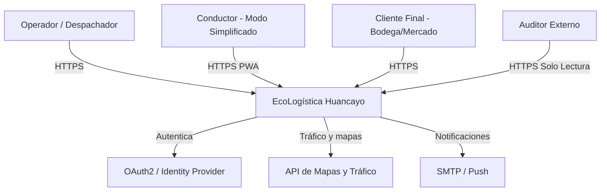
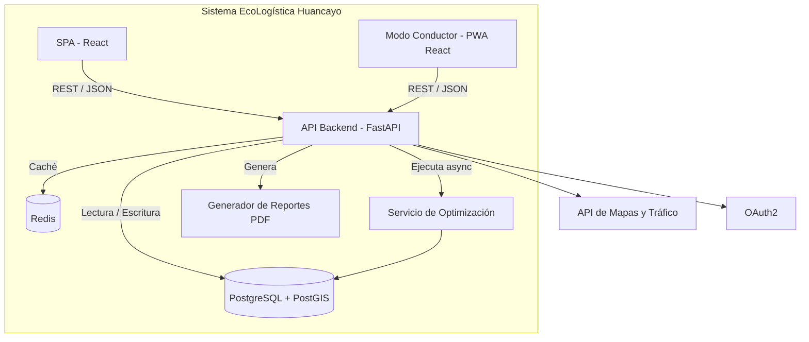
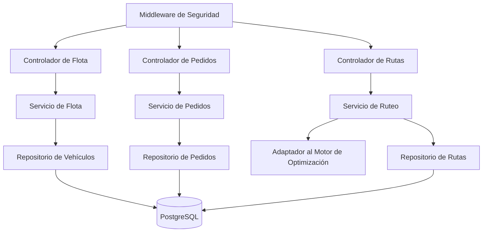

[← Volver al README Principal](../../../README.md)

# Arquitectura de Software

> **Estado actualizado:** PostgreSQL + PostGIS y Redis describen la arquitectura objetivo. El incremento local validado usa SQLite + R*Tree y caché en proceso; el staging preparado usa PostgreSQL HA. No se afirma un despliegue PostGIS/Redis sin evidencia de infraestructura.

**Proyecto:** EcoLogística Huancayo — Optimizador de Rutas Sostenibles para "DistriRápido S.A.C."
**Fecha:** 25 de septiembre de 2026 | **Sprint:** 1
**Elaborado por:** Manuel Yeferson Parraga Recuay, Sheila Suarez Suarez, David André Guevara Moscoso, Jair Felix Romero

---

## 1. Estilo Arquitectónico

El sistema se implementa siguiendo el **Modelo C4** (Contexto, Contenedores, Componentes) sobre una arquitectura de **capas desacoplada** (Controladores → Servicios → Repositorios), con el stack tecnológico definido en `docs/01 Inicio/10. Stack tecnológico V_1_0_0.md`: **Python (FastAPI)** en el backend, **React.js** en el frontend, **PostgreSQL + PostGIS** como base de datos y **Redis** como caché de sesión y de resultados de ruteo.

## 2. Nivel 1 — Diagrama de Contexto

## 3. Nivel 2 — Diagrama de Contenedores

## 4. Nivel 3 — Diagrama de Componentes (API Backend)

## 5. Alcance Implementado en el Sprint 1

Conforme al Sprint Planning (`docs/02 Planificación/02 Artefactos Jira V_1_0_0.md`), en este sprint se construye la base arquitectónica: middleware de seguridad (EN-02), configuración de auto-escalamiento (EN-01), failover de base de datos (EN-03), y los controladores/servicios/repositorios de **Flota** y **Pedidos** (US-001 a US-004). El motor de optimización (Servicio de Ruteo) queda definido en la arquitectura pero se implementa a partir del Sprint 2.

## 6. Decisiones Arquitectónicas Clave

| Decisión | Justificación |
|---|---|
| Arquitectura en capas (Controlador-Servicio-Repositorio) | Aísla la lógica de negocio del framework web, facilitando pruebas unitarias (DoD: cobertura ≥ 80%). |
| PostgreSQL + PostGIS | Soporte nativo de datos georreferenciados, requerido por RF-002, RF-003 y RF-004. |
| Redis como caché | Reduce la carga de recálculo de rutas ya generadas, apoyando el SLA de 45 segundos (RNF-001). |
| Middleware de seguridad centralizado | Punto único de control de acceso (RBAC) y auditoría, alineado a RNF-002. |
