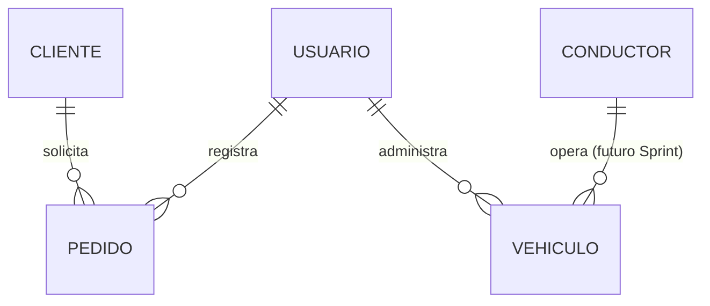

[← Volver al README Principal](../../../README.md)

# Diseño de la Base de Datos

**Proyecto:** EcoLogística Huancayo — Optimizador de Rutas Sostenibles para "DistriRápido S.A.C."
**Fecha:** 25 de septiembre de 2026 | **Sprint:** 1
**Motor:** PostgreSQL 16 + extensión PostGIS

---

## 1. Modelo Lógico

Entidades cubiertas por el alcance del Sprint 1 (Flota y Pedidos) más las entidades base de soporte (usuarios, clientes, conductores) necesarias para el resto del sistema.

| Entidad | Atributo | Tipo | Restricción | Origen |
|---|---|---|---|---|
| **usuarios** | usuario_id | UUID | PK | — |
| | email | VARCHAR(255) | NOT NULL, UNIQUE | — |
| | password_hash | VARCHAR(255) | NOT NULL | — |
| | rol | VARCHAR(30) | NOT NULL | RBAC, Documento 08 |
| **vehiculos** | vehiculo_id | UUID | PK | RF-001 |
| | placa | VARCHAR(10) | NOT NULL, UNIQUE | — |
| | tipo | VARCHAR(20) | NOT NULL | — |
| | capacidad_kg | NUMERIC(8,2) | NOT NULL, CHECK > 0 | — |
| | consumo_km_l | NUMERIC(6,2) | NOT NULL, CHECK > 0 | — |
| | factor_emision_co2 | NUMERIC(6,3) | NOT NULL | RN-008 |
| | anio_fabricacion | SMALLINT | NOT NULL | RN-002 |
| **conductores** | conductor_id | UUID | PK | RF-008 |
| | dni | VARCHAR(8) | NOT NULL, UNIQUE | — |
| | horas_conducidas_dia | NUMERIC(4,2) | CHECK ≤ 8 | RN-003 |
| **clientes** | cliente_id | UUID | PK | — |
| | nombre_negocio | VARCHAR(150) | NOT NULL | — |
| | distrito | VARCHAR(50) | NOT NULL | — |
| **pedidos** | pedido_id | UUID | PK | RF-002 |
| | cliente_id | UUID | FK → clientes | — |
| | coordenadas | GEOGRAPHY(POINT,4326) | NOT NULL | PostGIS |
| | punto_referencia | TEXT | NULLABLE | Direcciones no estándar |
| | peso_kg / volumen_m3 | NUMERIC | NOT NULL, CHECK > 0 | RN-006 |
| | ventana_inicio / ventana_fin | TIMESTAMPTZ | NOT NULL | RN-005 |
| | estado | VARCHAR(30) | NOT NULL, DEFAULT 'PENDIENTE' | — |

**Normalización:** el modelo cumple 3FN — cada atributo depende exclusivamente de la clave primaria de su propia entidad (ej. `factor_emision_co2` depende del vehículo, no del pedido ni de la ruta).

## 2. Modelo Conceptual (referencia rápida)



## 3. Modelo Físico (DDL SQL) — Alcance Sprint 1

```sql
CREATE EXTENSION IF NOT EXISTS postgis;
CREATE EXTENSION IF NOT EXISTS "pgcrypto";

CREATE TABLE usuarios (
    usuario_id UUID PRIMARY KEY DEFAULT gen_random_uuid(),
    email VARCHAR(255) NOT NULL UNIQUE,
    password_hash VARCHAR(255) NOT NULL,
    rol VARCHAR(30) NOT NULL CHECK (rol IN ('ADMINISTRADOR','OPERADOR','AUDITOR')),
    estado VARCHAR(20) NOT NULL DEFAULT 'ACTIVO',
    creado_en TIMESTAMP WITH TIME ZONE DEFAULT CURRENT_TIMESTAMP
);

CREATE TABLE vehiculos (
    vehiculo_id UUID PRIMARY KEY DEFAULT gen_random_uuid(),
    placa VARCHAR(10) NOT NULL UNIQUE,
    tipo VARCHAR(20) NOT NULL CHECK (tipo IN ('CAMIONETA','FURGON','MOTO')),
    capacidad_kg NUMERIC(8,2) NOT NULL CHECK (capacidad_kg > 0),
    consumo_km_l NUMERIC(6,2) NOT NULL CHECK (consumo_km_l > 0),
    factor_emision_co2 NUMERIC(6,3) NOT NULL CHECK (factor_emision_co2 >= 0),
    anio_fabricacion SMALLINT NOT NULL,
    creado_en TIMESTAMP WITH TIME ZONE DEFAULT CURRENT_TIMESTAMP
);

CREATE TABLE conductores (
    conductor_id UUID PRIMARY KEY DEFAULT gen_random_uuid(),
    nombre VARCHAR(150) NOT NULL,
    dni VARCHAR(8) NOT NULL UNIQUE,
    categoria_licencia VARCHAR(5) NOT NULL,
    horas_conducidas_dia NUMERIC(4,2) NOT NULL DEFAULT 0 CHECK (horas_conducidas_dia <= 8),
    creado_en TIMESTAMP WITH TIME ZONE DEFAULT CURRENT_TIMESTAMP
);

CREATE TABLE clientes (
    cliente_id UUID PRIMARY KEY DEFAULT gen_random_uuid(),
    nombre_negocio VARCHAR(150) NOT NULL,
    distrito VARCHAR(50) NOT NULL,
    creado_en TIMESTAMP WITH TIME ZONE DEFAULT CURRENT_TIMESTAMP
);

CREATE TABLE pedidos (
    pedido_id UUID PRIMARY KEY DEFAULT gen_random_uuid(),
    cliente_id UUID NOT NULL REFERENCES clientes(cliente_id),
    coordenadas GEOGRAPHY(POINT, 4326) NOT NULL,
    punto_referencia TEXT,
    peso_kg NUMERIC(8,2) NOT NULL CHECK (peso_kg > 0),
    volumen_m3 NUMERIC(6,2) NOT NULL CHECK (volumen_m3 > 0),
    prioridad VARCHAR(15) NOT NULL CHECK (prioridad IN ('EXPRESS','ESTANDAR','ECONOMICO')),
    ventana_inicio TIMESTAMP WITH TIME ZONE NOT NULL,
    ventana_fin TIMESTAMP WITH TIME ZONE NOT NULL CHECK (ventana_fin > ventana_inicio),
    estado VARCHAR(30) NOT NULL DEFAULT 'PENDIENTE',
    creado_en TIMESTAMP WITH TIME ZONE DEFAULT CURRENT_TIMESTAMP
);

-- Índices de soporte
CREATE INDEX idx_pedidos_estado ON pedidos(estado);
CREATE INDEX idx_pedidos_coordenadas ON pedidos USING GIST (coordenadas);
CREATE INDEX idx_vehiculos_placa ON vehiculos(placa);
CREATE INDEX idx_conductores_dni ON conductores(dni);
```

> Las tablas `rutas`, `ruta_detalle` y `reportes_sostenibilidad` (motor de optimización y reportes) se incorporan a partir del Sprint 2, conforme al alcance priorizado en el Backlog.
