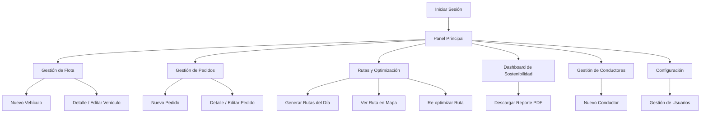
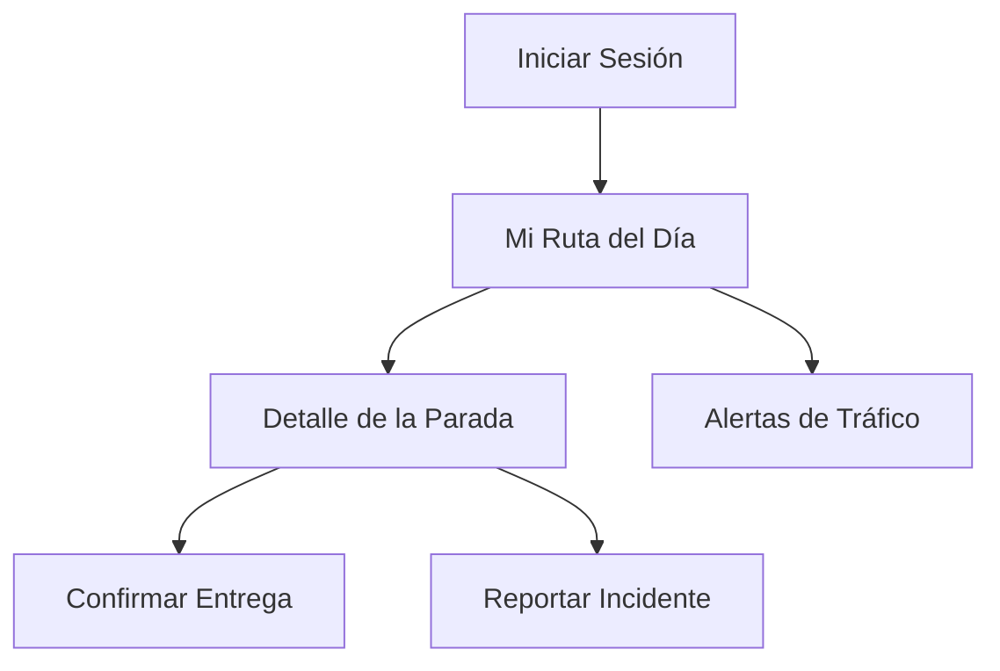

[← Volver al README Principal](../../../README.md)

# Mapa de Navegación

**Proyecto:** EcoLogística Huancayo — Optimizador de Rutas Sostenibles para "DistriRápido S.A.C."
**Fecha:** 25 de septiembre de 2026 | **Sprint:** 1

---

## 1. Mapa de Navegación General (SPA Administrativa)

## 2. Mapa de Navegación — Modo Conductor (PWA)

## 3. Descripción de Pantallas — Alcance Sprint 1

| Pantalla | Rol(es) con Acceso | Estado en Sprint 1 |
|---|---|---|
| Iniciar Sesión | Todos | Implementado (Enabler EN-02) |
| Panel Principal (Home) | Administrador, Operador | Implementado |
| Gestión de Flota (listar / nuevo / editar) | Administrador, Operador | Implementado (US-001, US-002) |
| Gestión de Pedidos (listar / nuevo / detalle) | Administrador, Operador, Cliente (limitado) | Implementado (US-003, US-004) |
| Rutas y Optimización | Administrador, Operador | Planificado — Sprint 2 |
| Dashboard de Sostenibilidad | Administrador, Auditor | Planificado — Sprint 3 |
| Modo Conductor completo | Conductor | Planificado — Sprint 3-4 |
| Gestión de Conductores | Administrador | Planificado — Sprint 4 |

## 4. Criterio de Navegación

- Toda pantalla protegida exige sesión iniciada; el sistema redirige a "Iniciar Sesión" ante un token expirado o inválido (regla transversal de EN-02, Seguridad).
- El menú principal solo muestra los módulos habilitados para el rol del usuario autenticado, conforme a la matriz RBAC (`docs/01 Inicio/08. Usuarios V_1_0_0.md`).
- El "Modo Conductor" se sirve como una ruta independiente y simplificada, optimizada para conexiones 3G (RNF-006) y accesible desde un enlace directo sin pasar por el panel administrativo.
