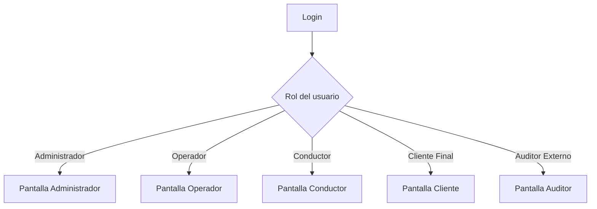

[← Volver al README Principal](../../../README.md)

# Sprint 2 — Requisitos, Login, Altas y Pantallas por Rol

**Proyecto:** EcoLogística Huancayo — Optimizador de Rutas Sostenibles para "DistriRápido S.A.C."
**Fecha de inicio:** 9 de octubre de 2026 | **Duración:** 2 semanas
**Equipo:** Manuel Yeferson Parraga Recuay, Sheila Suarez Suarez, David André Guevara Moscoso, Jair Felix Romero

---

## 1. Requisitos que se Usan en el Sprint 2

### 1.1. Requisitos funcionales

| Código | Requisito | Qué se hace en este sprint |
|---|---|---|
| RF-002 | Registro de Pedidos | Pantalla para **agregar pedido** (cliente, coordenadas o punto de referencia, peso, volumen, ventana de entrega, prioridad) |
| RF-008 | Registro y Gestión de Conductores | Pantalla para **agregar conductor** (nombre, DNI, categoría de licencia, experiencia, disponibilidad, contacto) |
| RF-001 | Registro de Vehículos | Se reutiliza lo hecho en el Sprint 1 (ya funcional) |

### 1.2. Requisitos no funcionales

| Código | Requisito | Aplicación |
|---|---|---|
| RNF-002 | Seguridad | Login con contraseña cifrada y sesión con token; acceso restringido por rol |
| RNF-005 | Usabilidad | Pantalla del conductor simple, con botones grandes e iconos |
| RNF-009 | Accesibilidad | Contraste alto y navegación por teclado en todas las pantallas |

### 1.3. Reglas de negocio

| Código | Regla | Dónde aplica |
|---|---|---|
| RN-001 | Tras 3 intentos fallidos de inicio de sesión, la cuenta se bloquea 15 minutos | Login |
| RN-003 | Un conductor no puede tener más de 8 horas de conducción continua | Agregar conductor |
| RN-005 | La ventana de entrega debe tener la hora de fin posterior a la de inicio | Agregar pedido |
| RN-006 | El peso y el volumen del pedido deben ser mayores a cero | Agregar pedido |

### 1.4. Historias de usuario del sprint

| ID | Historia |
|---|---|
| US-003 | Registrar un pedido con punto de referencia local |
| US-011 | Registrar un conductor |
| EN-02 | Seguridad de acceso (login y permisos por rol) |

---

## 2. Login

**Una sola pantalla de inicio de sesión para todos los roles.** Según el rol del usuario, el sistema lo lleva a su propia pantalla.

| Elemento | Detalle |
|---|---|
| Campos | Correo y contraseña |
| Éxito | Redirige a la pantalla del rol del usuario |
| Error | Mensaje "Correo o contraseña incorrectos" |
| Bloqueo | 3 intentos fallidos bloquean la cuenta 15 minutos (RN-001) |
| Sesión vencida | Redirige de nuevo al login |

---

## 3. Agregar Conductor (RF-008)

| Campo | Obligatorio | Validación |
|---|---|---|
| Nombre completo | Sí | Texto de 2 a 150 caracteres |
| DNI | Sí | 8 dígitos, único en el sistema |
| Categoría de licencia | Sí | Lista de categorías |
| Años de experiencia | Sí | Número entero mayor o igual a 0 |
| Disponibilidad horaria | Sí | Máximo 8 horas continuas (RN-003) |
| Teléfono de contacto | Sí | 9 dígitos |

**Quién puede agregar:** Administrador. El Operador solo consulta.

---

## 4. Agregar Pedido (RF-002)

| Campo | Obligatorio | Validación |
|---|---|---|
| Cliente | Sí | Debe existir en el sistema |
| Ubicación | Sí | Coordenadas GPS elegidas en el mapa, o punto de referencia (ej. "frente a la ferretería Andina") |
| Peso (kg) | Sí | Mayor a 0 (RN-006) |
| Volumen (m³) | Sí | Mayor a 0 (RN-006) |
| Ventana de entrega | Sí | Hora de fin posterior a la de inicio (RN-005) |
| Prioridad | Sí | Express, Estándar o Económico |

**Quién puede agregar:** Administrador y Operador. El Cliente Final registra solo sus propios pedidos.

---

## 5. Pantalla de Cada Rol

Cada rol entra por el mismo login y llega a **su propia pantalla**, que solo muestra lo que ese rol puede hacer.

| Rol | Pantalla | Qué puede hacer en el Sprint 2 | Requisitos |
|---|---|---|---|
| **Administrador** | Panel de administración | Agregar conductores, vehículos y pedidos; crear usuarios y asignar roles | RF-008, RF-001, RF-002, RNF-002 |
| **Operador / Despachador** | Panel de operaciones | Agregar y consultar pedidos; ver flota; consultar conductores | RF-002, RF-001, RF-008 |
| **Conductor** | Mi ruta del día (versión simple) | Ver sus datos y sus pedidos asignados, con botones grandes e iconos | RNF-005, RNF-009 |
| **Cliente Final** | Mis pedidos | Registrar un pedido y consultar su estado | RF-002 |
| **Auditor Externo** | Consulta (solo lectura) | Ver pedidos, flota y conductores sin poder modificar nada | RNF-002 |

### Acceso por pantalla (resumen)

| Módulo | Administrador | Operador | Conductor | Cliente | Auditor |
|---|---|---|---|---|---|
| Agregar conductor | Sí | No | No | No | No |
| Consultar conductores | Sí | Sí | Solo su perfil | No | Sí |
| Agregar pedido | Sí | Sí | No | Solo los suyos | No |
| Consultar pedidos | Sí | Sí | Los asignados | Los suyos | Sí |
| Gestión de flota | Sí | Sí | No | No | Solo lectura |
| Gestión de usuarios | Sí | No | No | No | No |
