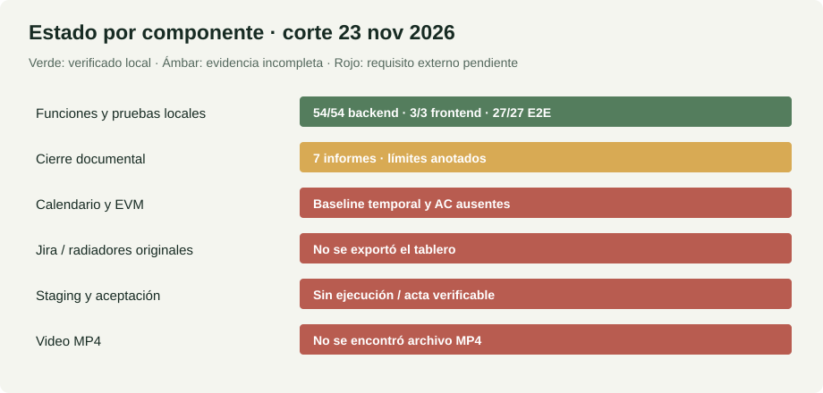
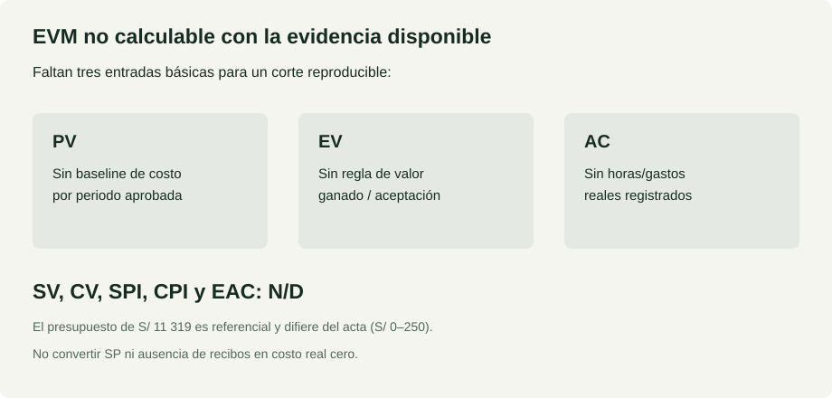
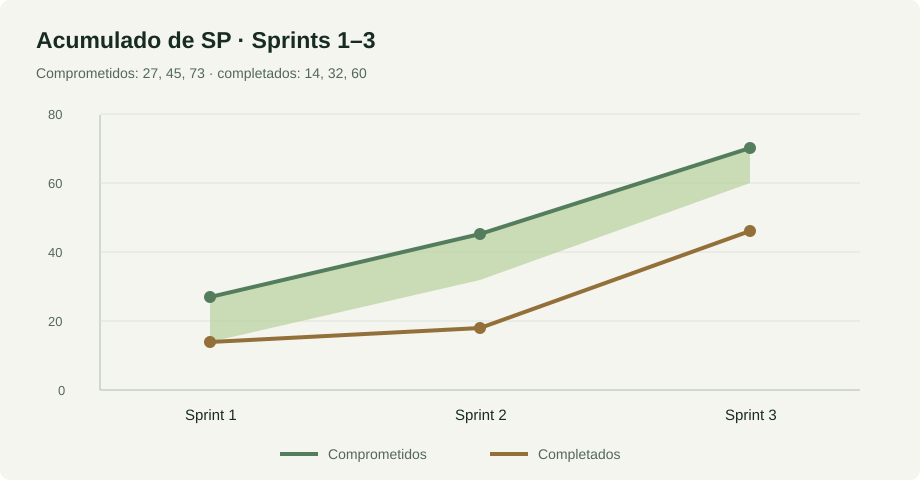
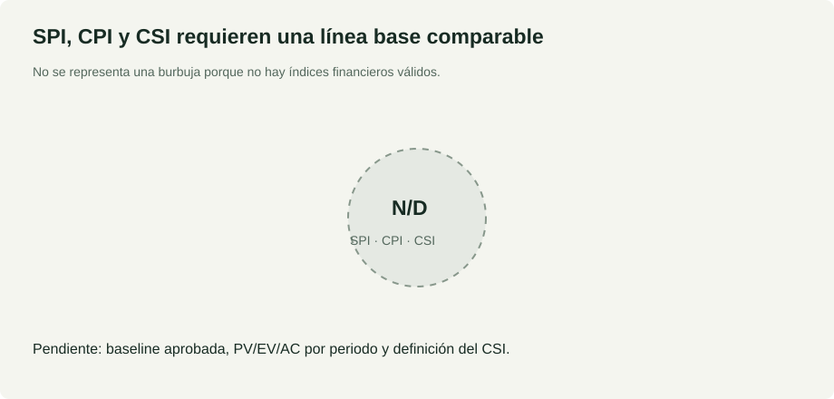
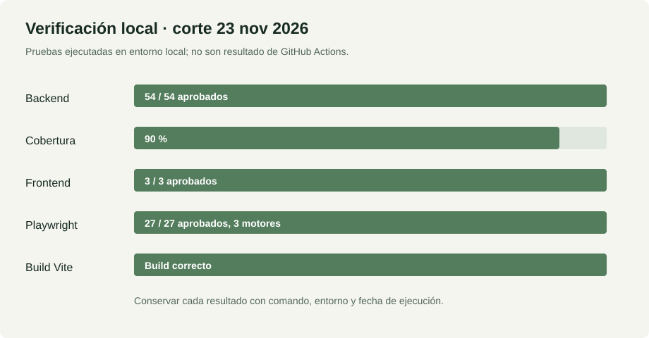

[← Volver al README principal](../../README.md)

# Tableros de Control Híbridos

**Proyecto:** EcoLogística Huancayo
**Frecuencia disponible:** cortes por sprint; el repositorio no guarda actualización diaria
**Fecha de corte:** 23/11/2026 · **Versión:** 1.0.0

## 1. Selección de métricas

Se muestran indicadores que ayudan al equipo y al patrocinador a distinguir entrega técnica, calidad y validaciones externas. Se evita mezclar story points con dinero y se omiten métricas EVM que no tienen fuente primaria.

## 2. Semáforo RAG por componente

| Componente | Enfoque | Estado | Evidencia / umbral |
|---|---|---|---|
| Incremento funcional local | Adaptativo | 🟢 Verde | Módulos presentes; flujos verificados en pruebas locales. |
| Calidad automatizada local | Adaptativo | 🟢 Verde | 54/54 backend, 90 % cobertura, 3/3 frontend, 27/27 E2E al corte local. |
| Gestión documental de cierre | Predictivo / adaptativo | 🟡 Ámbar | Siete informes elaborados; no todos los indicadores y radiadores tienen evidencia primaria. |
| Calendario y EVM | Predictivo | 🔴 Rojo | Sin baseline de calendario/costo calendarizada, costos reales ni regla EV aprobada. |
| Jira / radiadores originales | Adaptativo | 🔴 Rojo | No hay exportación ni captura del tablero en el repositorio. |
| Staging y aceptación de interesados | Predictivo / adaptativo | 🔴 Rojo | Configuración no demuestra ejecución; faltan entorno, acta y firma. |
| Video MP4 | Comunicación | 🔴 Rojo | No se encontró MP4; falta grabación de pitch y demostración. |

## 3. Indicadores gráficos

### 3.1 Tendencia EVM

**Interpretación:** PV, EV y AC no tienen registro temporal comparable; por lo tanto SV/CV/SPI/CPI y EAC no se grafican. El reporte [EVM](03%20Reporte%20de%20An%C3%A1lisis%20de%20Valor%20Ganado%20-%20EVM%20V_1_0_0.md) enumera las entradas pendientes.

### 3.2 Flujo acumulado de story points reportados

**Interpretación:** el gráfico acumula únicamente los puntos anotados en informes S1–S3: 27/14, 18/18 y 28/28 (comprometidos/completados). No es un CFD diario ni representa S4; los datos de Sprint 4 no están cuantificados en SP.

### 3.3 SPI vs. CPI con tamaño CSI

**Interpretación:** se omite el diagrama de burbujas porque el tamaño CSI y ambos índices requieren una base de costos/valor ganado que no existe. No se inventan coordenadas ni tamaño de burbuja.

### 3.4 Barras de verificación técnica local

**Interpretación:** son conteos de pruebas aprobadas y porcentaje de cobertura medidos en validaciones locales. No implican aprobación de CI remoto, auditoría UX, operación en producción ni aceptación del cliente.

## 4. Control de actualización

Actualizar al cierre de cada sprint y adjuntar fuente exportada. Los estados cambian solo con evidencia: reportes CI, aprobación de historia, auditoría fechada, recibos/horas, captura original del tablero o acta firmada. El detalle está en [Radiadores](05%20Radiadores%20de%20Informaci%C3%B3n%20V_1_0_0.md) y [Estado](01%20Reporte%20de%20Estado%20V_1_0_0.md).

## Historial de cambios

| Versión | Fecha | Cambio |
|---|---|---|
| 1.0.0 | 23/11/2026 | Tablero consolidado con métricas trazables y brechas explícitas. |
