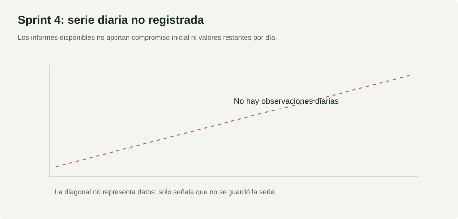
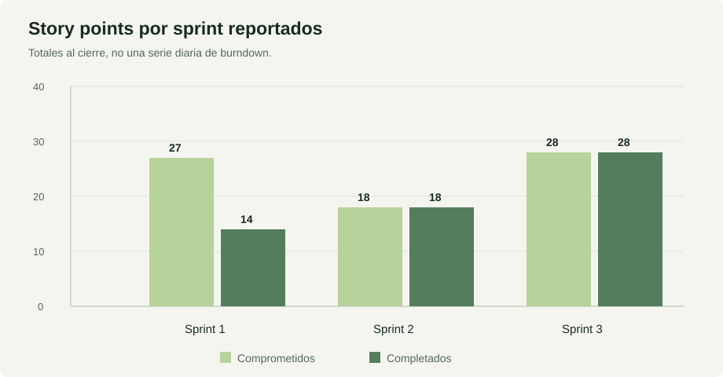
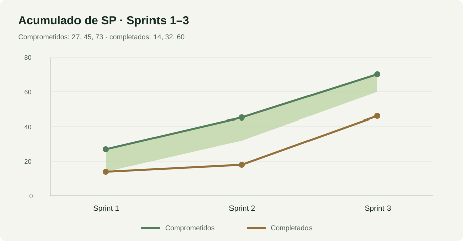
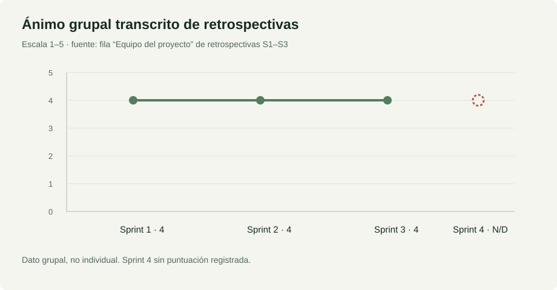

[← Volver al README principal](../../README.md)

# Radiadores de Información

**Proyecto:** EcoLogística Huancayo
**Marco ágil documentado:** Scrum con iteraciones y tablero previsto en Jira
**Fecha de corte:** 23/11/2026 · **Versión:** 1.0.0

> La consigna pide capturas reales. El repositorio dice expresamente que las exportaciones/capturas de Jira no están disponibles. Los gráficos de este informe son representaciones reproducibles de métricas escritas en los informes de sprint, no capturas del tablero ni reconstrucciones atribuidas a Jira.

## 1. Burndown: trabajo restante

| Sprint | SP comprometidos | SP completados | Pendientes al corte |
|---|---:|---:|---:|
| 1 | 27 | 14 | 13 |
| 2 | 18 | 18 | 0 |
| 3 | 28 | 28 | 0 |
| 4 | No registrado | No registrado | N/D |

**Análisis:** solo hay totales por sprint. No existen puntos restantes por día, tasa ideal diaria o cambios de alcance fechados, así que la imagen no se presenta como burndown diario real. Para cumplirlo, exportar el Burndown de Jira de cada iteración.

Como dato de cierre disponible, los informes sí registran los totales comprometidos y completados por sprint:

## 2. Burnup: alcance y trabajo aceptado

**Análisis:** al cierre de S3, los informes suman 73 SP comprometidos y 60 SP completados. La diferencia acumulada de 13 SP procede de S1. No hay datos de historia del alcance por fecha ni exportación de cambios de alcance; por ello el gráfico no representa cambios intrassprint ni avance de S4.

## 3. Tablero de tareas / Kanban

**Estado de la evidencia:** no se incluye captura. El documento de Artefactos Jira advierte que la cuenta externa no exportó el tablero. La siguiente tabla resume únicamente estados que están escritos en informes del repositorio:

| Elemento | Estado fuente | Evidencia | Qué falta |
|---|---|---|---|
| US-001 a US-004 | Hechos | Informe de Sprint 1 | Exportar tickets e historial de aceptación. |
| EN-01 / EN-03 | No completados en el corte S1; validación externa pendiente | Informe/impedimentos de Sprint 1 | Evidencia de staging y cierre de tickets. |
| EN-02 y elementos de Sprint 2 | Hechos según informe | Informe de Sprint 2 | Exportación del tablero/Jira. |
| US-007 a US-010 y EN-05 | Hechos localmente según informe S3 | Informe de Sprint 3 | Exportación de tickets y validación PostgreSQL. |
| QA-E2E / DOC-S4 | Entrega técnica verificada; no son historias | Revisión de Sprint 4 | Backlog Sprint 4 y vínculos a PR/aceptación. |
| Video, acta externa, SUS fuente | Pendientes de evidencia | Consigna y resumen de plataforma | Incorporar artefactos originales. |

La captura real de Task Board debe anexarse por el administrador de Jira. Esta tabla no se presenta como screenshot.

## 4. Mood chart

| Grupo evaluado en fuente | Sprint 1 | Sprint 2 | Sprint 3 | Sprint 4 |
|---|---:|---:|---:|---:|
| Equipo del proyecto, valoración grupal | 4/5 | 4/5 | 4/5 | N/D |

Las retrospectivas S1–S3 registran una sola fila “Equipo del proyecto”, no respuestas individuales. No es una serie anónima por integrante ni permite inferencia estadística. Sprint 4 no tiene puntuación de ánimo documentada.

## 5. Tableros de retrospectiva

**Evidencia:** existen retrospectivas Markdown de Sprints 1–4; no se encontraron capturas reales de pizarras. Los temas registrados son:

| Sprint | Funcionó | Oportunidad | Acción registrada |
|---|---|---|---|
| 1 | Historias funcionales pequeñas; integración local | Infraestructura no demostrada | Preparar evidencia reproducible de enablers. |
| 2 | Trazabilidad Git e integración por rol | Capturas Jira ausentes | Ampliar pruebas negativas de autorización. |
| 3 | Fixtures deterministas y timeout | Dependencia de OSM; staging/usuarios no disponibles | Mantener fixtures y revisar cambios en equipo. |
| 4 | E2E multi-navegador; reporte técnico con límites explícitos | Sin formularios SUS, historias Sprint 4 verificables ni staging | Pre-commit, manual de operaciones, taller y monitoreo fueron propuestos; verificar ejecución antes de marcarlos hechos. |

**Clima laboral:** las valoraciones grupales 4/5 de S1–S3 se transcriben de las retrospectivas existentes. No hay acta de reunión final o registro individual para Sprint 4.

## Evidencia original requerida para completar el criterio

- Exportación/captura del Burndown y Burnup de cada sprint.
- Captura del Task Board con fecha, filtros y estados visibles.
- Capturas originales de retrospectivas.
- Mood chart con método, fecha, escala y resultados anonimizados del equipo.

## Historial de cambios

| Versión | Fecha | Cambio |
|---|---|---|
| 1.0.0 | 23/11/2026 | Reúne indicadores disponibles sin simular evidencia externa. |
